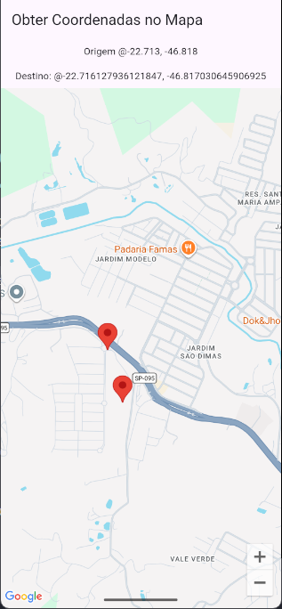

# Tuturiol - MAPS

| | |
|---|---|
| **Instituição** | SENAI |
| **Curso** | Técnico em Desenvolvimento de Sistemas |
| **Unidade curricular** | SESI CE 356 |
| **Atividade** | Tutorial Maps |
| **Aluno** | Matheus Guilherme Teixeira Silva |
| **Turma** | 3B |
| **Professores** | Wellington |
| **Data** | 30/09/2026 |

---

# Google Maps Flutter

Aplicativo Flutter desenvolvido para obter latitude e longitude através de cliques no Google Maps.

## Funcionalidades

- Exibição do Google Maps
- Marcador de origem
- Clique no mapa
- Obtenção da latitude
- Obtenção da longitude
- Marcador no local selecionado

## Tecnologias

- Flutter
- Dart
- Google Maps API
- google_maps_flutter

## Funcionamento

O aplicativo inicia o mapa próximo ao SESI Amparo.

Ao clicar em qualquer ponto do mapa, o aplicativo captura as coordenadas de latitude e longitude e adiciona um marcador no local selecionado.

## Print

---

---
